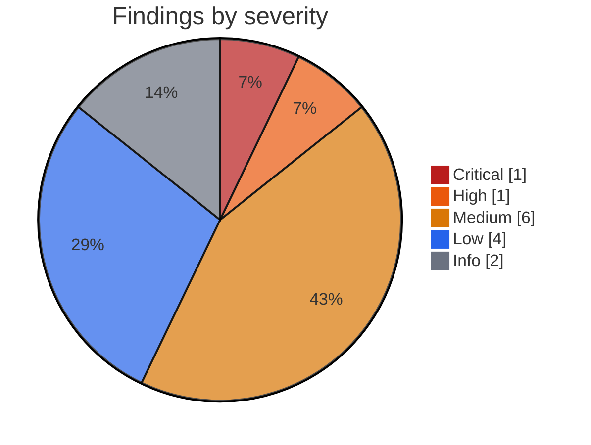
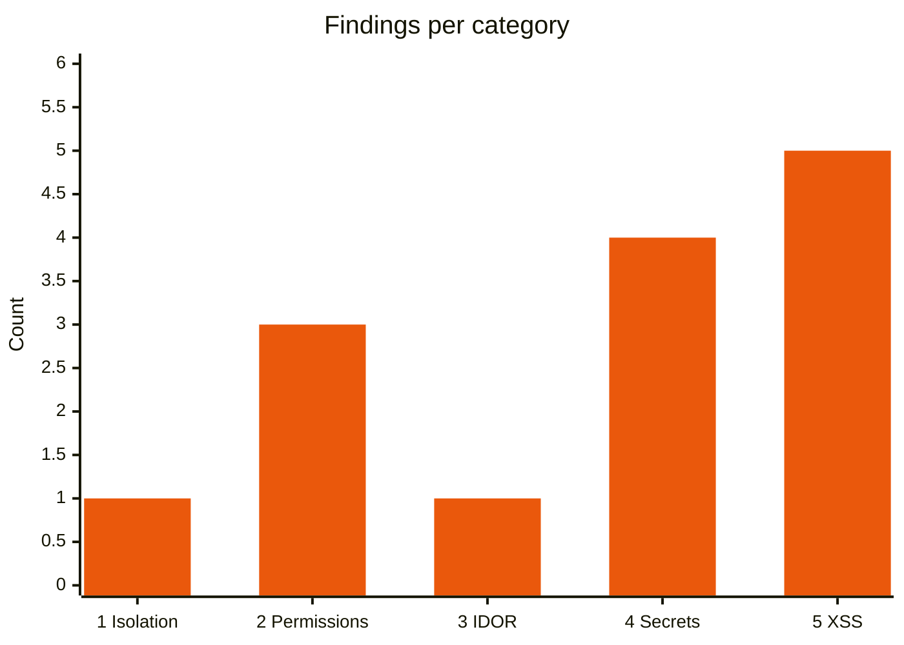

# Relatório de Auditoria de Segurança (Security Audit Report)

**Projeto:** `romalopes/wine_words_api`
**Issue:** #23 — Code Revision
**Data:** 2026-11-21
**Escopo:** API Rails (`wine_words_api`): controllers, policies, models, services, initializers, views, deploy config e histórico git — leitura apenas (nenhum arquivo de produção alterado).

**Metodologia (stack detectada):** aplicação **Ruby 3.4 / Rails 8.1** monolítica: **PostgreSQL** via **ActiveRecord**, autenticação **Devise + devise-jwt** (Bearer JWT), autorização **Pundit**, frontend **Hotwire (Turbo + Stimulus) + views ERB server-rendered** (o SPA React vive em outro repositório), deploy **Docker + Kamal + Render**, **rack-attack**, **Sentry**. Cada uma das 5 categorias da issue foi mapeada para o equivalente desta stack:

| Categoria (issue) | Equivalente nesta stack | Como foi verificado |
|---|---|---|
| 1. Banco sem tranca | `policy_scope` + `authorize` + filtros de visibilidade (sem RLS) | Varredura de todos os controllers, policies e `Analytics::Scope` |
| 2. Permissão no navegador | Helpers ERB/React de papel vs `before_action`/Pundit no servidor | Cruzamento de cada gate de UI com o guard do endpoint |
| 3. IDOR | `find`/`find_by` + `authorize` + scoping por `current_user` | Leitura de todos os `set_*` e ações `show/update/destroy` |
| 4. Chaves expostas | `.env*`, `master.key`, credentials, ENV, histórico git | `git ls-files`/`git log -S`, grep de padrões de chave |
| 5. Inputs sem tratamento | `raw`/`html_safe`/`innerHTML` em ERB + Stimulus, templates de e-mail | Grep de sinks e leitura do contexto de cada ocorrência |

> Total de achados verificados: **14** (apenas problemas reais). Pontos fortes verificados são listados separadamente para provar a cobertura.


## 1. Resumo executivo

| Severidade | Qtd |
|---|---:|
| 🔴 **Critical** | 1 |
| 🟠 **High** | 1 |
| 🟡 **Medium** | 6 |
| 🔵 **Low** | 4 |
| ⚪ **Info** | 2 |
| **Total** | **14** |

**Legenda de cores:** 🔴 Crítica `#B91C1C` · 🟠 Alta `#EA580C` · 🟡 Média `#D97706` · 🔵 Baixa `#2563EB` · ⚪ Informativa · 🟢 Ponto forte `#059669`.

### Achados por severidade (rosca)




### Achados por categoria (barras)




| Categoria | Achados |
|---|---:|
| 1. Tenant / Owner Isolation (Banco sem Tranca) | 1 |
| 2. Browser-Defined Permission vs Server Enforcement | 3 |
| 3. IDOR (Insecure Direct Object Reference) | 1 |
| 4. Exposed Secrets (Chaves Expostas) | 4 |
| 5. Untreated Inputs / XSS | 5 |

**Leitura rápida:** há **1 achado crítico e 1 alto**, ambos de **controle de acesso**: quatro controllers server-rendered expõem CRUD de catálogo **sem autenticação**, e `/api/v1/wine_profiles` aceita escrita de **qualquer usuário logado** (sem papel). O segundo risco central é **XSS armazenado** nos formulários ERB (categoria 5); em seguida **JWT de 100 anos** e **login sem rate-limit** (categoria 4).


## 2. Pontos fortes (verificados)

| | Evidência | O que está protegido |
|---|---|---|
| 🟢 **Strong** | `app/controllers/api/v1/articles_controller.rb:24` | Article & Review feeds are policy-scoped — policy_scope(articles) + Article.visible_to scope; drafts only to author/managers. |
| 🟢 **Strong** | `app/services/analytics/scope.rb:69-105` | Analytics reporting uses a single role-scoped boundary — Reviewers see own content only; Editors content-scoped; Admins site-wide; out-of-scope detail returns nil → 404. |
| 🟢 **Strong** | `app/controllers/api/v1/notifications_controller.rb:84` | Per-user collections scoped to current_user — current_user.notifications.delivered.find(...) and current_user.push_subscriptions.find(...) prevent cross-user reads. |
| 🟢 **Strong** | `app/controllers/api/v1/trade/messages_controller.rb:39-48` | Trade guest access is token-bound — Owner (submitter_id) OR valid guest token; uniform 404 otherwise — no ID probing. |
| 🟢 **Strong** | `app/policies/user_policy.rb:4-14` | Server re-checks every role the UI hides — assign_roles/assign_subscription/soft_delete/hard_delete require user&.admin?; create/search/show require catalogue_manager. ERB/React gates are advisory only. |
| 🟢 **Strong** | `app/controllers/wines_controller.rb:7` | Server-rendered management forms guard writes — before_action :deny_unless_wine_manager! on new/create/edit/update/destroy; articles controller uses ensure_author!. |
| 🟢 **Strong** | `app/controllers/api/v1/reviews_controller.rb:244,285,301,317` | Pundit authorize runs after every find — show/create/update/destroy all call authorize @review; set_review scopes through the review relation. |
| 🟢 **Strong** | `app/controllers/api/v1/images_controller.rb:9-66` | Image mutations are type-allowlisted and authorized — ALLOWED_TYPES allowlist + authorize @record, :update? before create/destroy/reorder/set_primary. |
| 🟢 **Strong** | `app/controllers/api/v1/comments_controller.rb:60-79` | Comment edit/delete check ownership/moderation — permission.can_edit?/can_delete? gate update/destroy. |
| 🟢 **Strong** | `.gitignore:1-8` | No secrets are committed; env/key files are ignored — /.env* (except .env.example), /config/*.key, scripts/age-keys.txt ignored. `git ls-files` has no master.key; history has no sk_live_/AKIA/PRIVATE KEY. |
| 🟢 **Strong** | `app/services/billing/providers/stripe.rb:301-310` | Provider secrets come from the environment — Stripe webhook signature verified with ENV['STRIPE_WEBHOOK_SECRET'] via Stripe::Webhook.construct_event; API key read from ENV only. |
| 🟢 **Strong** | `config/initializers/filter_parameter_logging.rb:6-10` | Sensitive params filtered from logs — passw, email, secret, token, message, _key, crypt, salt, certificate, otp, ssn, cvv, cvc filtered. |
| 🟢 **Strong** | `app/javascript/controllers/quiz_controller.js:78-92,208-215` | Stimulus controllers escape interpolated data — Every innerHTML interpolation passes through this.escape() (and wine_search_controller.js likewise). |
| 🟢 **Strong** | `app/helpers/regions_helper.rb:2-50` | Region tree renders via content_tag/link_to (auto-escaped) — render_regions_tree builds nodes with content_tag/link_to, so .html_safe on the result wraps already-escaped markup. |
| 🟢 **Strong** | `app/models/image.rb:9-72` | Image uploads validated for type and size — ALLOWED_CONTENT_TYPES (jpeg/png/webp/gif) + 10MB cap. |


## 3. Pontos fracos (riscos centrais)

1. **CRÍTICO — CRUD de catálogo sem autenticação:** `WineProfilesController`, `TasteParametersController`, `TestParametersController` e `WineTasteParametersController` herdam de `ActionController::Base` sem `RequireLogin`/`before_action`, expondo `POST/PATCH/DELETE` desses recursos a qualquer visitante. As versões JSON equivalentes em `Api::V1::*` estão protegidas — o buraco é só nas rotas web.
2. **ALTO — `/api/v1/wine_profiles` sem papel:** escrita liberada a qualquer usuário autenticado (não existe `WineProfilePolicy`).
3. **XSS armazenado nos forms ERB** (`wines/_form`, `articles/_form`, `articles/edit`, `reviews/_form`): `innerHTML`/`raw` com nomes de uva/vinho/título de review sem escape.
4. **Sessão sem expiração + login sem limite:** JWT válido por 100 anos e nenhum throttle/`lockable` em `/api/v1/auth/sign_in`.
5. **Turnstile ausente no intake de trade**, apesar do comentário em contrário.


## 4. Achados detalhados por categoria


### 1. Tenant / Owner Isolation (Banco sem Tranca)

| Severidade | Arquivo:linha | Descrição |
|---|---|---|
| ⚪ **Info** | `db/schema.rb:n/a` | **Isolation is application-layer only (no DB Row-Level Security)** — Single-tenant model (no tenant_id). Isolation depends entirely on Pundit/controllers; a missing authorize in future code silently leaks. Consider RLS or a deny-by-default test harness as defense-in-depth. |

**Pontos fortes verificados:** Article & Review feeds are policy-scoped (`app/controllers/api/v1/articles_controller.rb:24`); Analytics reporting uses a single role-scoped boundary (`app/services/analytics/scope.rb:69-105`); Per-user collections scoped to current_user (`app/controllers/api/v1/notifications_controller.rb:84`); Trade guest access is token-bound (`app/controllers/api/v1/trade/messages_controller.rb:39-48`).


### 2. Browser-Defined Permission vs Server Enforcement

| Severidade | Arquivo:linha | Descrição |
|---|---|---|
| ⚪ **Info** | `app/controllers/articles_controller.rb:144-150` | **UI role helpers are duplicated in ERB views** — can_manage_article? / can_manage_wines? drive button visibility. Controllers enforce the same rules today — keep them in sync; a drift would only hide/show buttons, not grant access. |
| 🔴 **Critical** | `app/controllers/wine_profiles_controller.rb:1-43` | **Unauthenticated catalogue CRUD on server-rendered controllers (no auth at all)** — WineProfilesController, TasteParametersController (app/controllers/taste_parameters_controller.rb:1-43), TestParametersController and WineTasteParametersController inherit ActionController::Base with NO before_action, NO RequireLogin and NO authorize — anyone can POST/PATCH/DELETE /wine_profiles, /taste_parameters, /wine_taste_parameters, /test_parameters (config/routes.rb:64,65,101,102). The matching JSON API controllers DO authorize; only the web copies are open. |
| 🟠 **High** | `app/controllers/api/v1/wine_profiles_controller.rb:29-53` | **API wine_profiles mutations allow any authenticated user** — create/update/destroy only require the global authenticate_user! (line 13 skips it for read-only actions). There is no WineProfilePolicy and no role guard, so a self-registered Guest/Reader can create, modify or delete wine profiles via /api/v1/wine_profiles (config/routes.rb:220). |

**Pontos fortes verificados:** Server re-checks every role the UI hides (`app/policies/user_policy.rb:4-14`); Server-rendered management forms guard writes (`app/controllers/wines_controller.rb:7`).


### 3. IDOR (Insecure Direct Object Reference)

| Severidade | Arquivo:linha | Descrição |
|---|---|---|
| 🔵 **Low** | `app/controllers/api/v1/admin/trade/quotes_controller.rb:79-85` | **Trade quote lookup ignores the package in the URL** — set_quote = WinePackageQuote.find(params[:id]) and set_package_for_quote uses @quote.wine_package, so the :package_id segment is not enforced. Reachable only by catalogue managers (ensure_trade_manager!), so impact is low; bind the quote to the package to remove ambiguity. |

**Pontos fortes verificados:** Pundit authorize runs after every find (`app/controllers/api/v1/reviews_controller.rb:244,285,301,317`); Image mutations are type-allowlisted and authorized (`app/controllers/api/v1/images_controller.rb:9-66`); Comment edit/delete check ownership/moderation (`app/controllers/api/v1/comments_controller.rb:60-79`).


### 4. Exposed Secrets (Chaves Expostas)

| Severidade | Arquivo:linha | Descrição |
|---|---|---|
| 🟡 **Medium** | `config/initializers/devise.rb:321-323` | **JWT access tokens effectively never expire** — jwt.expiration_time = 100.years.to_i. A stolen bearer token stays valid until an explicit sign_out (JwtDenylist) or soft-delete. Set a bounded TTL (e.g. 30-60 min) + refresh or sliding renewal. |
| 🟡 **Medium** | `config/initializers/rack_attack.rb:10-63` | **No login brute-force protection (no lockable, no auth throttle)** — Rack::Attack throttles analytics/contact/trade/invitations but NOT /api/v1/auth/sign_in; the User model omits Devise :lockable. Add a per-IP+per-email sign-in throttle and/or :lockable. |
| 🔵 **Low** | `config/initializers/devise.rb:17` | **Commented secret-looking value committed** — `# config.secret_key = '3b5ce8...'` (Devise generator placeholder) left in source. Remove it; real key is secret_key_base. Not exploitable as-is (real key unused) but should not ship. |
| 🔵 **Low** | `db/seeds/e2e.rb:5` | **Default password fallback in e2e seeds** — ENV.fetch('E2E_USER_PASSWORD', 'Playwright123!'). Guarded by `abort unless Rails.env.e2e?`, so it cannot run in prod; keep the guard and never reuse this value elsewhere. |

**Pontos fortes verificados:** No secrets are committed; env/key files are ignored (`.gitignore:1-8`); Provider secrets come from the environment (`app/services/billing/providers/stripe.rb:301-310`); Sensitive params filtered from logs (`config/initializers/filter_parameter_logging.rb:6-10`).


### 5. Untreated Inputs / XSS

| Severidade | Arquivo:linha | Descrição |
|---|---|---|
| 🟡 **Medium** | `app/views/wines/_form.html.erb:151,165-168` | **Stored XSS via grape name in wine form** — `raw(...).to_json` inside <script> and `selectedBox.innerHTML = ... + g.name`. A grape name containing </script> or HTML executes in the editor's browser when the wine form loads. Catalogue managers set grape names. |
| 🟡 **Medium** | `app/views/articles/_form.html.erb:213,418,433,463` | **Stored XSS via review title / wine name in article form** — span.innerHTML = "<strong>" + review.title + … and "<strong>" + wine.name. Same pattern in app/views/articles/edit.html.erb:107,127. Reviewer-authored titles execute in other editors' browsers. |
| 🟡 **Medium** | `app/views/reviews/_form.html.erb:196` | **Stored XSS via wine name in review form** — done.innerHTML = "<strong>" + wine.name + … — wine names are catalogue-manager controlled. |
| 🔵 **Low** | `config/initializers/content_security_policy.rb:12-13` | **CSP allows unsafe-inline and unsafe-eval** — script_src includes :unsafe_inline, :unsafe_eval. A nonce is also set (mitigates inline <script>), but unsafe_eval weakens defences; remove once inline handlers are gone. |
| 🟡 **Medium** | `app/controllers/api/v1/trade/submissions_controller.rb:6,35-68` | **Public trade submissions skip Turnstile despite the comment** — Comment says Turnstile is enforced; neither controller nor Trade::Submissions::Create verifies it. Only Rack::Attack (10/hour/IP) guards intake. Add Turnstile verification like the contact form. |

**Pontos fortes verificados:** Stimulus controllers escape interpolated data (`app/javascript/controllers/quiz_controller.js:78-92,208-215`); Region tree renders via content_tag/link_to (auto-escaped) (`app/helpers/regions_helper.rb:2-50`); Image uploads validated for type and size (`app/models/image.rb:9-72`).


## 4. Recomendações priorizadas

**P0 — bloquear imediatamente**
0. **Fechar o CRUD web não autenticado:** incluir `RequireLogin` + guard de papel (`deny_unless_wine_manager!`/`catalogue_manager?`) em `WineProfilesController`, `TasteParametersController`, `TestParametersController` e `WineTasteParametersController`; adicionar `authorize` + criar `WineProfilePolicy` em `Api::V1::WineProfilesController`.

**P1 — corrigir nesta sprint**
1. **Escape nos forms ERB (XSS):** trocar `innerHTML = "... " + valor` por `textContent`/`createElement`, e trocar `raw(...).to_json` por `json_escape(...)` dentro do `<script>` (`wines/_form`, `articles/_form`, `articles/edit`, `reviews/_form`).
2. **Expiração de JWT:** reduzir `jwt.expiration_time` para 30–60 min (com refresh/sliding) ou impor TTL absoluto.
3. **Rate limit + lockout no login:** adicionar throttle `auth/sign_in` por IP e por e-mail no `rack_attack.rb` e/ou `:lockable` no Devise.

**P2 — próximo ciclo**
4. **Turnstile no intake de trade** (igual ao form de contato) e alinhar o comentário com o código.
5. **CSP:** remover `:unsafe_inline`/`:unsafe_eval` após eliminar handlers inline; manter o nonce.
6. **Trade quote:** amarrar `set_quote` ao `params[:package_id]`.

**P3 — hardening contínuo**
7. Remover o `secret_key` comentado em `devise.rb` e o default de senha em `db/seeds/e2e.rb` (manter guard).
8. Adicionar um teste deny-by-default que garanta `authorize`/`policy_scope` em todo controller novo (defesa para a ausência de RLS).
9. Avaliar Row-Level Security no PostgreSQL como segunda barreira de isolamento.


## 5. ISSUES PARA O GITHUB

Cada bloco abaixo está pronto para copiar e colar como issue. Total: 12.

--- ISSUE 1 ---
**Título:** [Segurança] Unauthenticated catalogue CRUD on server-rendered controllers (no auth at all)
**Labels sugeridas:** security, sev-critical, permissions

### Descrição
WineProfilesController, TasteParametersController (app/controllers/taste_parameters_controller.rb:1-43), TestParametersController and WineTasteParametersController inherit ActionController::Base with NO before_action, NO RequireLogin and NO authorize — anyone can POST/PATCH/DELETE /wine_profiles, /taste_parameters, /wine_taste_parameters, /test_parameters (config/routes.rb:64,65,101,102). The matching JSON API controllers DO authorize; only the web copies are open.

### Evidência
`app/controllers/wine_profiles_controller.rb:1-43`

### Impacto
Critical — ver resumo executivo para a exploração detalhada desta categoria.

### Sugestão de correção
Ver "Recomendações priorizadas" (P1/P2/P3) no relatório.

### Critérios de aceite
- [ ] O sink/vetor apontado em `app/controllers/wine_profiles_controller.rb:1-43` foi corrigido.
- [ ] Teste automatizado que reproduz o problema passa a falhar sem a correção.
- [ ] Nenhum novo achado com a mesma classe foi introduzido na revisão de PR.
--- FIM ISSUE 1 ---

--- ISSUE 2 ---
**Título:** [Segurança] API wine_profiles mutations allow any authenticated user
**Labels sugeridas:** security, sev-high, permissions

### Descrição
create/update/destroy only require the global authenticate_user! (line 13 skips it for read-only actions). There is no WineProfilePolicy and no role guard, so a self-registered Guest/Reader can create, modify or delete wine profiles via /api/v1/wine_profiles (config/routes.rb:220).

### Evidência
`app/controllers/api/v1/wine_profiles_controller.rb:29-53`

### Impacto
High — ver resumo executivo para a exploração detalhada desta categoria.

### Sugestão de correção
Ver "Recomendações priorizadas" (P1/P2/P3) no relatório.

### Critérios de aceite
- [ ] O sink/vetor apontado em `app/controllers/api/v1/wine_profiles_controller.rb:29-53` foi corrigido.
- [ ] Teste automatizado que reproduz o problema passa a falhar sem a correção.
- [ ] Nenhum novo achado com a mesma classe foi introduzido na revisão de PR.
--- FIM ISSUE 2 ---

--- ISSUE 3 ---
**Título:** [Segurança] Trade quote lookup ignores the package in the URL
**Labels sugeridas:** security, sev-low, idor

### Descrição
set_quote = WinePackageQuote.find(params[:id]) and set_package_for_quote uses @quote.wine_package, so the :package_id segment is not enforced. Reachable only by catalogue managers (ensure_trade_manager!), so impact is low; bind the quote to the package to remove ambiguity.

### Evidência
`app/controllers/api/v1/admin/trade/quotes_controller.rb:79-85`

### Impacto
Low — ver resumo executivo para a exploração detalhada desta categoria.

### Sugestão de correção
Ver "Recomendações priorizadas" (P1/P2/P3) no relatório.

### Critérios de aceite
- [ ] O sink/vetor apontado em `app/controllers/api/v1/admin/trade/quotes_controller.rb:79-85` foi corrigido.
- [ ] Teste automatizado que reproduz o problema passa a falhar sem a correção.
- [ ] Nenhum novo achado com a mesma classe foi introduzido na revisão de PR.
--- FIM ISSUE 3 ---

--- ISSUE 4 ---
**Título:** [Segurança] JWT access tokens effectively never expire
**Labels sugeridas:** security, sev-medium, secrets

### Descrição
jwt.expiration_time = 100.years.to_i. A stolen bearer token stays valid until an explicit sign_out (JwtDenylist) or soft-delete. Set a bounded TTL (e.g. 30-60 min) + refresh or sliding renewal.

### Evidência
`config/initializers/devise.rb:321-323`

### Impacto
Medium — ver resumo executivo para a exploração detalhada desta categoria.

### Sugestão de correção
Ver "Recomendações priorizadas" (P1/P2/P3) no relatório.

### Critérios de aceite
- [ ] O sink/vetor apontado em `config/initializers/devise.rb:321-323` foi corrigido.
- [ ] Teste automatizado que reproduz o problema passa a falhar sem a correção.
- [ ] Nenhum novo achado com a mesma classe foi introduzido na revisão de PR.
--- FIM ISSUE 4 ---

--- ISSUE 5 ---
**Título:** [Segurança] No login brute-force protection (no lockable, no auth throttle)
**Labels sugeridas:** security, sev-medium, secrets

### Descrição
Rack::Attack throttles analytics/contact/trade/invitations but NOT /api/v1/auth/sign_in; the User model omits Devise :lockable. Add a per-IP+per-email sign-in throttle and/or :lockable.

### Evidência
`config/initializers/rack_attack.rb:10-63`

### Impacto
Medium — ver resumo executivo para a exploração detalhada desta categoria.

### Sugestão de correção
Ver "Recomendações priorizadas" (P1/P2/P3) no relatório.

### Critérios de aceite
- [ ] O sink/vetor apontado em `config/initializers/rack_attack.rb:10-63` foi corrigido.
- [ ] Teste automatizado que reproduz o problema passa a falhar sem a correção.
- [ ] Nenhum novo achado com a mesma classe foi introduzido na revisão de PR.
--- FIM ISSUE 5 ---

--- ISSUE 6 ---
**Título:** [Segurança] Commented secret-looking value committed
**Labels sugeridas:** security, sev-low, secrets

### Descrição
`# config.secret_key = '3b5ce8...'` (Devise generator placeholder) left in source. Remove it; real key is secret_key_base. Not exploitable as-is (real key unused) but should not ship.

### Evidência
`config/initializers/devise.rb:17`

### Impacto
Low — ver resumo executivo para a exploração detalhada desta categoria.

### Sugestão de correção
Ver "Recomendações priorizadas" (P1/P2/P3) no relatório.

### Critérios de aceite
- [ ] O sink/vetor apontado em `config/initializers/devise.rb:17` foi corrigido.
- [ ] Teste automatizado que reproduz o problema passa a falhar sem a correção.
- [ ] Nenhum novo achado com a mesma classe foi introduzido na revisão de PR.
--- FIM ISSUE 6 ---

--- ISSUE 7 ---
**Título:** [Segurança] Default password fallback in e2e seeds
**Labels sugeridas:** security, sev-low, secrets

### Descrição
ENV.fetch('E2E_USER_PASSWORD', 'Playwright123!'). Guarded by `abort unless Rails.env.e2e?`, so it cannot run in prod; keep the guard and never reuse this value elsewhere.

### Evidência
`db/seeds/e2e.rb:5`

### Impacto
Low — ver resumo executivo para a exploração detalhada desta categoria.

### Sugestão de correção
Ver "Recomendações priorizadas" (P1/P2/P3) no relatório.

### Critérios de aceite
- [ ] O sink/vetor apontado em `db/seeds/e2e.rb:5` foi corrigido.
- [ ] Teste automatizado que reproduz o problema passa a falhar sem a correção.
- [ ] Nenhum novo achado com a mesma classe foi introduzido na revisão de PR.
--- FIM ISSUE 7 ---

--- ISSUE 8 ---
**Título:** [Segurança] Stored XSS via grape name in wine form
**Labels sugeridas:** security, sev-medium, xss

### Descrição
`raw(...).to_json` inside <script> and `selectedBox.innerHTML = ... + g.name`. A grape name containing </script> or HTML executes in the editor's browser when the wine form loads. Catalogue managers set grape names.

### Evidência
`app/views/wines/_form.html.erb:151,165-168`

### Impacto
Medium — ver resumo executivo para a exploração detalhada desta categoria.

### Sugestão de correção
Ver "Recomendações priorizadas" (P1/P2/P3) no relatório.

### Critérios de aceite
- [ ] O sink/vetor apontado em `app/views/wines/_form.html.erb:151,165-168` foi corrigido.
- [ ] Teste automatizado que reproduz o problema passa a falhar sem a correção.
- [ ] Nenhum novo achado com a mesma classe foi introduzido na revisão de PR.
--- FIM ISSUE 8 ---

--- ISSUE 9 ---
**Título:** [Segurança] Stored XSS via review title / wine name in article form
**Labels sugeridas:** security, sev-medium, xss

### Descrição
span.innerHTML = "<strong>" + review.title + … and "<strong>" + wine.name. Same pattern in app/views/articles/edit.html.erb:107,127. Reviewer-authored titles execute in other editors' browsers.

### Evidência
`app/views/articles/_form.html.erb:213,418,433,463`

### Impacto
Medium — ver resumo executivo para a exploração detalhada desta categoria.

### Sugestão de correção
Ver "Recomendações priorizadas" (P1/P2/P3) no relatório.

### Critérios de aceite
- [ ] O sink/vetor apontado em `app/views/articles/_form.html.erb:213,418,433,463` foi corrigido.
- [ ] Teste automatizado que reproduz o problema passa a falhar sem a correção.
- [ ] Nenhum novo achado com a mesma classe foi introduzido na revisão de PR.
--- FIM ISSUE 9 ---

--- ISSUE 10 ---
**Título:** [Segurança] Stored XSS via wine name in review form
**Labels sugeridas:** security, sev-medium, xss

### Descrição
done.innerHTML = "<strong>" + wine.name + … — wine names are catalogue-manager controlled.

### Evidência
`app/views/reviews/_form.html.erb:196`

### Impacto
Medium — ver resumo executivo para a exploração detalhada desta categoria.

### Sugestão de correção
Ver "Recomendações priorizadas" (P1/P2/P3) no relatório.

### Critérios de aceite
- [ ] O sink/vetor apontado em `app/views/reviews/_form.html.erb:196` foi corrigido.
- [ ] Teste automatizado que reproduz o problema passa a falhar sem a correção.
- [ ] Nenhum novo achado com a mesma classe foi introduzido na revisão de PR.
--- FIM ISSUE 10 ---

--- ISSUE 11 ---
**Título:** [Segurança] CSP allows unsafe-inline and unsafe-eval
**Labels sugeridas:** security, sev-low, xss

### Descrição
script_src includes :unsafe_inline, :unsafe_eval. A nonce is also set (mitigates inline <script>), but unsafe_eval weakens defences; remove once inline handlers are gone.

### Evidência
`config/initializers/content_security_policy.rb:12-13`

### Impacto
Low — ver resumo executivo para a exploração detalhada desta categoria.

### Sugestão de correção
Ver "Recomendações priorizadas" (P1/P2/P3) no relatório.

### Critérios de aceite
- [ ] O sink/vetor apontado em `config/initializers/content_security_policy.rb:12-13` foi corrigido.
- [ ] Teste automatizado que reproduz o problema passa a falhar sem a correção.
- [ ] Nenhum novo achado com a mesma classe foi introduzido na revisão de PR.
--- FIM ISSUE 11 ---

--- ISSUE 12 ---
**Título:** [Segurança] Public trade submissions skip Turnstile despite the comment
**Labels sugeridas:** security, sev-medium, xss

### Descrição
Comment says Turnstile is enforced; neither controller nor Trade::Submissions::Create verifies it. Only Rack::Attack (10/hour/IP) guards intake. Add Turnstile verification like the contact form.

### Evidência
`app/controllers/api/v1/trade/submissions_controller.rb:6,35-68`

### Impacto
Medium — ver resumo executivo para a exploração detalhada desta categoria.

### Sugestão de correção
Ver "Recomendações priorizadas" (P1/P2/P3) no relatório.

### Critérios de aceite
- [ ] O sink/vetor apontado em `app/controllers/api/v1/trade/submissions_controller.rb:6,35-68` foi corrigido.
- [ ] Teste automatizado que reproduz o problema passa a falhar sem a correção.
- [ ] Nenhum novo achado com a mesma classe foi introduzido na revisão de PR.
--- FIM ISSUE 12 ---


---

### Apêndice — regenerar e renderizar (A4)

```bash
# Regenera este relatório a partir dos achados versionados no script:
ruby docs/security-audit/generate_report.rb

# (opcional) PDF A4 com gráficos (pandoc + weasyprint + mermaid-cli):
pandoc audity-security-report.md -o audit.pdf --pdf-engine=weasyprint -V geometry:margin=2cm
```

_Nenhum binário de PDF (pandoc/wkhtmltopdf/weasyprint) estava instalado no ambiente da auditoria; o `.md` é a fonte canônica e renderiza no GitHub (incluindo Mermaid `pie`/`xychart`)._
